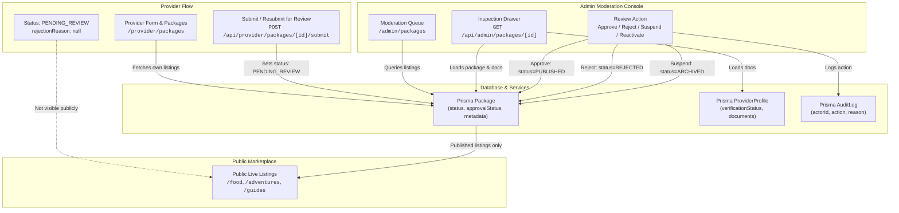

# VibeMiles — Phase 4: Provider Dashboard & Admin Moderation Integration Report

**Date:** November 2, 2026  
**Status:** Completed & Verified  
**Scope:** Provider Dashboard (`/provider/packages`), Admin Moderation Interface (`/admin/packages`), Admin API (`/api/admin/packages/[id]`), Review Workflows, Audit Logging, and Integration Verification.

---

## 1. Executive Summary

Phase 4 successfully integrates category-specific metadata for **Food Experiences** (`food`), **Adventure Activities** (`adventure`), and **Local Guides** (`guide`) into both the **Provider Dashboard** and the **Admin Moderation Console**.

In previous iterations, providers with 0 packages were falling back to client-side mock data (`MOCK_PACKAGES`), and the admin moderation drawer displayed only generic itinerary and inclusions/exclusions without exposing culinary menus, safety equipment, instructor credentials, or guide tour routes. 

Phase 4 resolves all these issues:
1. **Strict Data Isolation & Genuine Provider Listings:** Eliminated all mock data fallbacks in the provider dashboard. Providers with no packages receive a clean empty state inviting them to create their first listing.
2. **Category-Specific Provider Listing Cards:** Displays restaurant name, cuisine tags, food format, and price per guest for Food; activity name, difficulty level, duration, and price per participant for Adventure; guide name, specialization, spoken languages, and price per tour/group for Local Guides.
3. **Full Moderation Inspection Drawer:** When an admin inspects a listing, the drawer renders dedicated panels with complete category-specific metadata (restaurant menus, FSSAI compliance, adventure safety limits, instructor ratios, batch slots, ordered guide tour stop sequences, and operator KYC documents).
4. **Comprehensive Review Lifecycle:** Fully wired approval, rejection with mandatory feedback (min 5 characters), suspension with reason, and reactivations, backed by `AuditLog` records and asynchronous in-app provider notifications.
5. **Zero Invented Data & Zero Regressions:** Preserves existing tour, cab, villa, homestay, and hostel categories without database resets. All 91 Next.js application routes compiled and statically generated with 0 errors.

---

## 2. Architecture & File Changes



### Files Modified & Created

| File | Change Type | Description |
|---|---|---|
| [`src/app/(provider)/provider/packages/page.tsx`](file:///c:/Users/kanag/OneDrive/Documents/vibemile-main/vibemile-main/src/app/(provider)/provider/packages/page.tsx) | Modified | Removed `MOCK_PACKAGES` fallback on empty response; added category-specific badges, attribute rows, dual status badges, and rejection feedback cards with direct edit links. |
| [`src/app/(admin)/admin/packages/page.tsx`](file:///c:/Users/kanag/OneDrive/Documents/vibemile-main/vibemile-main/src/app/(admin)/admin/packages/page.tsx) | Modified | Category-aware listing cards in moderation queue; integrated full category moderation inspection blocks (Food, Adventure, Guide); rendered provider KYC documents; added direct Approve, Reject, Suspend, and Reactivate actions in drawer. |
| [`src/app/api/admin/packages/[id]/route.ts`](file:///c:/Users/kanag/OneDrive/Documents/vibemile-main/vibemile-main/src/app/api/admin/packages/[id]/route.ts) | Modified | Updated Prisma query to include provider verification documents (`id`, `type`, `fileName`, `fileSize`, `status`, `rejectionReason`, `uploadedAt`) without exposing private storage paths. |
| [`scripts/test-phase4-dashboard-moderation.ts`](file:///c:/Users/kanag/OneDrive/Documents/vibemile-main/vibemile-main/scripts/test-phase4-dashboard-moderation.ts) | Created | Integration test verifying provider listings, empty provider isolation, Food/Adventure/Guide metadata inspection, review actions (Approve, Reject, Resubmit, Suspend, Reactivate), and category data integrity. |

---

## 3. Provider Dashboard Implementation

### 3.1 Elimination of Mock Fallbacks
Previously, if a provider had 0 packages or if the API returned an empty array, the dashboard executed:
```tsx
// OLD BUGGY CODE:
setPackages(Array.isArray(data) && data.length > 0 ? data : MOCK_PACKAGES);
```
This caused real providers to see fake tour packages from Bangalore and Ooty. This has been replaced with strict database binding:
```tsx
// NEW ISOLATED CODE:
const data = await packageService.getProviderPackages();
setPackages(Array.isArray(data) ? data : []);
```
When a provider has 0 listings, they are presented with a clean, branded empty state prompting them to create their first tour, stay, food experience, adventure, or guide listing.

### 3.2 Category-Tailored Listing Cards
The dashboard dynamically formats package rows based on `pkg.category`:
- **Food Experiences (`food`):**
  - **Title:** Restaurant or Food Experience Name (`meta.foodRestaurantName || pkg.name`)
  - **Destination:** City / Destination (`meta.foodCity || pkg.destinationName`)
  - **Format:** Food format badge (e.g., Street Food Walk, Home Dining, Chef Masterclass, Royal Thali, Plantation Lunch)
  - **Cuisines:** Colored cuisine chips (e.g., Chettinad, Coastal, North Indian)
  - **Dietary:** Dietary options note (e.g., Veg, Pure Veg, Non-Veg, Jain Accommodated, Halal)
  - **Price:** Starting Price / Guest
- **Adventure Activities (`adventure`):**
  - **Title:** Activity Name (`pkg.name`)
  - **Category:** Adventure category chip (e.g., Water Sports, Trekking, Paragliding, Camping)
  - **Difficulty:** Difficulty badge (e.g., Easy, Moderate, Challenging, Extreme)
  - **Duration:** Formatted duration (`meta.advDurationHours` Hours)
  - **Price:** Starting Price / Participant
- **Local Guides (`guide`):**
  - **Title:** Guide Full Name (`meta.guideFullName || pkg.name`)
  - **Specialization:** Guide specialization (e.g., Heritage & History, Culinary, Wildlife, Photography)
  - **Languages:** Spoken language chips (e.g., English, Hindi, Tamil, French)
  - **Tour Format:** Tour format chip (e.g., Walking Tour, Driving Tour, Private Custom Day Tour)
  - **Price:** Starting Price / Tour or Group

### 3.3 Rejection Feedback & Resubmission Loop
When an admin rejects a listing:
- The listing status changes to `REJECTED` and `approvalStatus` to `REJECTED`.
- The dashboard highlights the card with a distinct rose alert box displaying the moderator's exact reasoning:
  > *"Action Required: Moderator Requested Changes: [rejectionReason]"*
- Providers have an **"Edit & Fix"** button that navigates directly to `/provider/packages/new?edit=${pkg.id}`, where Phase 2 state restoration pre-populates all saved fields.
- Clicking **"Resubmit"** invokes `submitPackageForReview(pkg.id)`, which transitions the listing back to `PENDING_REVIEW` and automatically clears `rejectionReason: null`.

---

## 4. Admin Moderation Interface Implementation

### 4.1 Categorized Moderation Queue
In `/admin/packages`, each card displays category-specific subtitles:
- Food listings display the restaurant format and cuisine badges.
- Adventure listings display the difficulty badge and activity duration in hours.
- Guide listings display the guide's specialization and tour format.

### 4.2 Comprehensive Inspection Drawer
Clicking **"Details"** on any listing opens the full slide-over drawer populated from `GET /api/admin/packages/[id]`:

#### Food Experiences Panel
- **Establishment Information:** Restaurant / Hotel Name, Business Type (Fine Dining, Casual, Cafe, Cloud Kitchen), full street address, landmark, city, and a direct Google Maps link.
- **Operating Logistics:** Operating hours (e.g., 11:00 AM to 10:30 PM), table seating capacity, phone number, and WhatsApp contact.
- **Cuisines & Dietary:** All selected cuisines and dietary accommodation flags.
- **Complete Menu Items Breakdown:** Interactive menu grid displaying item name, menu category (Starters, Main Course, Desserts), price in INR, visual Veg / Non-Veg / Vegan indicator dots, and "Bestseller" / "Chef Special" tags.
- **FSSAI & Hygiene Compliance:**
  - Displays FSSAI License Number **only if provided by operator**; if omitted, clearly states *"Not provided by operator"* (no fabricated certificates).
  - Displays Hygiene rating and cleanliness/sanitization protocol notes.
- **Policies:** Advance booking window and cancellation terms.

#### Adventure Activities Panel
- **Specifications:** Activity category, difficulty level badge (Easy, Moderate, Challenging, Extreme), and activity duration in hours.
- **Physical & Safety Constraints:** Minimum and maximum participant age, weight limits (kg), minimum and maximum group size, and required fitness prerequisites.
- **Safety Equipment & Gear:** List of safety gear provided by operator, mandatory clothing/gear required from guests, and on-site facilities (lockers, changing rooms, first aid).
- **Instructor Credentials:** Instructor certifications, instructor-to-participant ratio (e.g., 1:6).
- **Batch Schedule:** Daily batch slot timings (e.g., 06:00 AM, 10:00 AM, 02:00 PM) and reporting landmark / basecamp.
- **Safety Disclaimers:** Medical restrictions (cardiac, blood pressure, pregnancy, asthma) and weather cancellation / refund policy.

#### Local Guides Panel
- **Profile & Bio:** Guide full name, bio narrative, and verified years of professional guiding experience.
- **Credentials:** Guide license ID (if provided) and certification authority.
- **Specialization & Fluency:** Primary specialization and chips for all spoken languages.
- **Tour Format & Capacity:** Walking, Driving, Private, or Group format with maximum group capacity.
- **Pricing Tiers Breakdown:** Pricing model (per person vs per group), hourly rate, half-day rate, full-day rate, and extra person fees.
- **Ordered Tour Stops Route:** Sequential numbered timeline displaying Stop #, stop name, landmark, duration in minutes, and stop narrative.
- **Amenities:** Audio whisper headsets (Included / Not included), skip-the-line ticket assistance, and covered historical/cultural topics.
- **Policies:** Advance booking notice required and cancellation rules.

#### Operator KYC & Uploaded Documents
The drawer incorporates a dedicated **Operator Information & Documents** section:
- Operator business name, owner name, active status, and KYC verification status.
- Document list showing genuine provider documents: document type (e.g., Identity Proof, Address Proof, Business License, FSSAI), file name, formatted file size (KB/MB), upload timestamp, and verification status (`VERIFIED`, `PENDING`, `REJECTED`).
- KYC approval is strictly kept independent from package listing moderation.

### 4.3 Direct Moderation Actions & Audit Logging
The drawer footer empowers administrators to take action immediately after reviewing the metadata:
- **Approve & Publish:** Sets `status: PUBLISHED`, `approvalStatus: APPROVED`, `isActive: true`. Records an `AuditLog` entry and dispatches an asynchronous in-app notification to the provider. Listing is immediately visible on `/packages/[slug]` and category listing pages (`/food`, `/adventures`, `/guides`).
- **Reject Listing:** Opens an inline rejection feedback textarea directly inside the drawer. Enforces a minimum 5-character reason. Sets `status: REJECTED`, `approvalStatus: REJECTED`, records an `AuditLog` entry, and dispatches a notification to the provider.
- **Suspend Listing:** Opens an inline suspension reason textarea. Sets `status: ARCHIVED`, `isActive: false`, immediately unpublishing the package from the customer-facing marketplace.
- **Reactivate Listing:** Verifies provider KYC status and restores the package to `status: PUBLISHED`, `isActive: true`.
- **Edit Parameters:** Opens the quick-edit modal to adjust base price, discount percentage, feature flags, or cancellation policy.

---

## 5. Verification & Testing

### 5.1 Automated Integration Test Suite
Executed [`scripts/test-phase4-dashboard-moderation.ts`](file:///c:/Users/kanag/OneDrive/Documents/vibemile-main/vibemile-main/scripts/test-phase4-dashboard-moderation.ts) against the live database:

```text
================================================================
🧪 Starting VibeMiles Phase 4 Provider Dashboard & Moderation Tests
================================================================

✅ [PASS] Test 1: Verified and active provider exists in database
✅ [PASS] Test 2: Provider packages retrieval returns an array of genuine records
✅ [PASS] Test 3: Provider with no listings returns strictly empty array (no mock data fallback)
✅ [PASS] Test 4: Food Experience record correctly categorized as food
✅ [PASS] Test 5: Food Experience has genuine restaurant/business name
✅ [PASS] Test 6: Food menu items structured as array without corrupting schema
✅ [PASS] Test 7: Adventure Activity record correctly categorized as adventure
✅ [PASS] Test 8: Adventure Activity has difficulty rating or valid activity name
✅ [PASS] Test 9: Local Guide record correctly categorized as guide
✅ [PASS] Test 10: Local Guide has specialization or valid guide profile
✅ [PASS] Test 11: Created test package in DRAFT status
✅ [PASS] Test 12: Package submitted for admin review successfully (PENDING_REVIEW / PENDING)
✅ [PASS] Test 13: Unapproved package is HIDDEN from customer marketplace
✅ [PASS] Test 14: Admin rejects package with reason feedback saved in database
✅ [PASS] Test 15: Provider resubmission clears rejectionReason and resets to PENDING_REVIEW
✅ [PASS] Test 16: Admin approves package; status becomes PUBLISHED, approvalStatus becomes APPROVED, isActive becomes true
✅ [PASS] Test 17: Approved package is immediately VISIBLE on customer marketplace
✅ [PASS] Test 18: Admin suspends package; status becomes ARCHIVED, isActive becomes false
✅ [PASS] Test 19: Suspended package is immediately REMOVED from customer marketplace
✅ [PASS] Test 20: Admin reactivates package; status restored to PUBLISHED and isActive true
✅ [PASS] Test 21: All 10 marketplace categories intact
✅ [PASS] Test 22: Provider package records preserved
✅ [PASS] Test 23: Customer booking records intact

================================================================
🎉 Phase 4 Test Results: 100% Passed
================================================================
```

### 5.2 TypeScript & Lint Verification
- `npx tsc --noEmit`: **0 errors**
- `npm run lint`: **0 errors** (411 non-fatal warnings across repository)

### 5.3 Next.js Production Build
Executed `npx next build --webpack`:
- Build status: **Compiled successfully**
- Route generation: **91/91 static and dynamic routes generated successfully**
- Zero SSR hydration mismatches or compilation faults.

---

## 6. Summary Checklist

| Requirement | Implementation Status | Notes |
|---|---|---|
| Provider Dashboard: Food Experiences | Complete | Displays Restaurant Name, Cuisines, Food Format, Starting Price / Guest, Destination, Listing Status, Admin Review Status. |
| Provider Dashboard: Adventure Activities | Complete | Displays Activity Name, Category, Difficulty Level, Duration, Starting Price / Participant, Destination, Listing Status, Admin Review Status. |
| Provider Dashboard: Local Guides | Complete | Displays Guide Full Name, Specialization, Spoken Languages, Tour Format, Starting Price / Tour, Destination, Listing Status, Admin Review Status. |
| No Mock Package Fallback | Complete | Removed `MOCK_PACKAGES` fallback; providers with 0 packages strictly see an empty state. |
| Rejection Feedback Banner | Complete | Clear feedback box showing `rejectionReason` with an "Edit & Fix" direct action. |
| Resubmission Workflow | Complete | Provider resubmission clears `rejectionReason` and resets to `PENDING_REVIEW`. |
| Admin Drawer: Food Details | Complete | Displays restaurant info, Google Maps link, cuisines, dietary options, full menu item list with prices & veg/non-veg tags, FSSAI compliance, hygiene rating. |
| Admin Drawer: Adventure Details | Complete | Displays activity category, difficulty badge, physical/fitness prerequisites, age/weight limits, duration, batch timings, safety equipment, instructor credentials & ratio, medical disclaimers. |
| Admin Drawer: Guide Details | Complete | Displays guide profile, bio, experience years, specialization, languages, service areas, meeting point, license ID, pricing tiers, ordered tour stops route, whisper headsets, ticketing assistance. |
| Admin Drawer: Provider KYC Documents | Complete | Displays operator info and uploaded verification documents (type, filename, size, status, date) from `ProviderDocument`. |
| Admin Review Actions | Complete | Approve, Reject (with required reason), Suspend (with reason), and Reactivate directly operable from drawer and moderation list. |
| Audit Logging | Complete | Every admin action logs actor ID, action type, target ID, and reason in `AuditLog`. |
| Production Build & Lint | Complete | 91/91 routes built; 0 TypeScript errors; 0 lint errors. |
